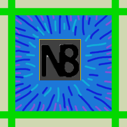

# N8Vision — Alpha

A free, open-source image library for browsing ANY (not just generated) images, pruning files,
inspecting metadata and preparing selected subjects for editing.

Uses a seamless Infinite Scroll to recursively browse every folder beneath assigned Root directories.
You can scroll Up from the top of the list to see the bottom, without having to navigate to Argentina
first.

Comes with a built-in remote-access portal. LAN/Wi-Fi only requires scanning an on-screen QR-code
(or typing in the link below it) for instant pairing. http remote connection requires you have an
address of your own, but I just learned they're stupid cheap, so skip one baconator and buy a domain.

**Official alpha: I.2t-l-Z3s.** [Download the complete package](https://github.com/Kokunekosan/N8Vision/releases/tag/vI.2t-l-Z3s).
No patch stacking is needed. Bug reports are welcome in [Issues](https://github.com/Kokunekosan/N8Vision/issues).

Run **Check-for-Updates.cmd** to check for a newer official alpha and download its complete ZIP. It leaves installation to you and does not interrupt active jobs.

## Install and launch

Windows prerequisites: Python **3.14** with the `py` launcher. Blurred/Full also
need Git for their pinned image-quality dependency.

1. Extract the complete ZIP into an empty application folder.
2. Run **install.cmd** and choose the capacity you need.
3. Run **N8Vision.cmd**, or an explicit Lite/Blurred/Full launcher.

All profiles share one installed `.venv`. Add capacity later by running
install.cmd again in that same folder. Launching Lite from a Full installation
keeps the heavier functions disabled. Downloads occur during installation or
when an optional feature is prepared; source packages contain no model weights.
The browser opens after the server becomes ready.

| Profile | Tools |
| --- | --- |
| Lite | Archive maintenance, thumbnails, browsing, selection, filesystem actions, stored filters and manual annotations. |
| Blurred | Lite plus detectors, quality inspection, embeddings, similarity/uniqueness, SAM and existing ComfyUI/refinement/training tools. |
| Full | Blurred plus selected-image subject assembly, preferred-language-model inspection and learned composite classes. |

## Updating an existing installation

Stop N8Vision, back up your existing installation, and replace application source
files from the complete ZIP. Preserve your `.venv`, `data`, `cache`, models,
training projects and settings. Restart using the desired profile and refresh
all browsers. The download contains no personal archive or machine configuration.
Do not initialize or run a GitHub publishing checkout; use a separate live copy.

## Browsing and mobile

- Directory-change discovery and automatic archive inspections retain the browsing position.
- Equivalent feature names merge into badges and filters while detector attribution stays available in the inspector.
- Settings provides an explicit preview/cleanup of observations from missing local detectors. Reviewed/owned observations require an additional opt-in for removal.
- Phones/tablets load a bounded image window and remember desired column counts separately by orientation. Search, sorting and Shown actions operate on that loaded window.
- Mobile Menu and Filters switch cards. **Clear Selected** is directly below the hamburger.
- Inspector and mask studio support **+/− zoom**, **Fit**, **WASD** panning and a touch stick. Framing moves image/mask/box layers together.

Recent polish includes optional desktop library windows, quicker first-card
display, immediate completed-row redraw, responsive selection/file actions,
inclusive selection across offscreen images, moved-image hand-truck markers,
collapsible menu sections, and mobile Back dismissing the active panel.
Desktop window size is configured in Settings / Library, in steps of 1,000.
Cross-window inclusive selection is supported for unfiltered Filesystem order;
an unavailable anchor in other views is reported rather than guessed.

## Latest update - October 22, 2026

- Ultimate SD Upscale now has a dedicated action with editable scale, denoise,
  tiling and seam controls, an expandable LoRA chain and the connected checkpoint VAE.
- Refine and Upscale keep settings independently, including their opt-in checkbox.
  Destination is a compact chooser: select Replace, Beside or Output before sending.
- Workshop node pickers no longer stop at 30 matches. Clearly video/audio-specific
  tools are excluded; shared image-processing tools remain available.
- Comfy recovery timeout follows batch inactivity, with each returned result
  extending the window. Batch status shows the number complete.
- New and regenerated same-name outputs clear stale placeholders. Automatic grid
  refresh prepares visible cards first and retries deferred batch refreshes.
- The move picker reuses the folder architecture already discovered by the library.
- Diagnostic badges refresh on changed assets. Idle Vision models are released
  after two minutes; Comfy handoff also releases idle models.
- Atomic active-job journals preserve more useful interruption diagnostics.

An isolated report of Beside removing its original remains unconfirmed. See
[known issues and reporting details](KNOWN-ISSUES.md) if it happens again.

## Nightly fixes — October 18, 2026

- Explore detects created/removed folders, including empty ones, using background
  directory checks. Tree changes do not rebuild or reposition the image grid.
- Ctrl+A and Select Shown exclude deleted/moved placeholders and queued moves.
- Settings / Ignore contents adds editable filename, full-path and wildcard rules.
  Default: log.html. Matching files stay on disk; save reloads library counts.
- Successful ComfyUI Replace recovery invalidates old masks, detections, quality
  receipts, embeddings and corrections, refreshes file stats and cached identity.
  Beside/output-only modes preserve the original. Frozen teaching examples remain.
- Replacement invalidation applies after updating, not to already completed edits.
  Wait for active batches to finish before updating. Running inference jobs are
  not cancelled by this mechanism; general external-edit monitoring is not added.

## Previous fixes

- Inclusive selection follows the browsed direction across the desktop ring origin.
- Move destination folders appear immediately from a visited-folder cache, with
  validation in the background. The picker remembers the last destination.
- The server reuses folder listings until their directory signature changes;
  first visits still enumerate. Directory timestamps can also change on file actions.
- Move batches release selection immediately and execute sequentially, letting you
  gather the next batch. Completed moves receive hand-truck markers; failures are
  reported. The queue lives in the browser session: keep the tab open until done.

## Subject tools: selected images, on demand

These are specialist tools for images you plan to work on. Select the intended
images before assembly or language-model inspection; they are not whole-library
background jobs. Fast YOLO-based inspection remains available separately.

Full includes BiRefNet-based separation. For the optional **PartGLEE** or
**LangHOPS** object/part backends, run **Install-SubjectParts.cmd**, choose a
backend, and use **Assemble selected subjects**. These reconstruction backends
currently require NVIDIA CUDA. PartGLEE weights are about 0.8GB plus shared
resources; the LangHOPS checkpoint is about 16GB plus shared resources.

For language-model interrogation, select an image-capable model in Prompt
Translator settings and connect the existing ComfyUI environment. Inspection
sends the assembled subject pixels on gray; draft names/features appear in the
inspector. The preferred LM is configurable. LangHOPS's internal PaliGemma model
is a separate parser dependency and requires the user's own approved Hugging
Face access. Never put access tokens in issue reports or source files.

Parts and ownership begin as drafts. Explicitly choose owners for manual masks.
Use **Use language-model class** (or correct the Subject label), then **Learn
Subject**, to save a confirmed composite lesson.

## Composite class training

A shared visual recognizer learns new classes from confirmed masked composites.
It trains a supervised class head on frozen pretrained visual features; it does
not fine-tune your preferred LM or the anatomy/ownership parser. Ownership and
mask corrections remain valuable teaching records for future parser work.

Start with at least **two classes** and **three distinct source images per
class**. Classes with insufficient examples wait for more teaching. Training
fits class heads on frozen CLIP features, checks source-separated validation,
and admits qualifying classes independently; a failing class need not block
successful classes. Rejected updates retain the prior active model. Exact
labels remain separate classes, so overlapping concepts need varied examples.

Automatic inference never teaches itself. **Learn Subject** records explicit
manual teaching; automatic training after these commits can be disabled.
The training-button light shows progress, and its diagnostics drawer explains
per-class validation and deferrals. Incomplete classes stay visible in the menu.
Learned recognition assigns draft labels to unidentified separated subjects;
review them before treating them as confirmed. A previous validated model can
be restored.

## Alpha status and testing

Source/API checks, controlled real encoder/class-training tests, archive checks
and simulated mobile/framing control tests passed. The developer has exercised
mobile browsing, remote inspection and subject identification in live use.
The latest mobile Back guard still needs broader Android/iOS device testing.
A clean Internet installation and every GPU/Comfy combination have not been
end-to-end tested. Report edition/version, device and reproduction steps with
bugs; remove tokens, personal paths and private image content from shared logs.

Feature work is frozen through **Friday, October 16, 2026**; changes during this
period are limited to polishing, fixes, compatibility and documentation.

## License and model terms

N8Vision source is [MIT licensed](LICENSE): free to use, modify and redistribute.
Dependencies and downloaded models retain their own terms. In particular,
[LangHOPS](https://github.com/y9miao/LangHOPS-release) is an optional
**CC BY-NC-SA 4.0** research backend; N8Vision's MIT license does not relicense it.
[PartGLEE](https://github.com/ProvenceStar/PartGLEE) and gated PaliGemma resources
are downloaded separately. Review their upstream terms for your intended use.
